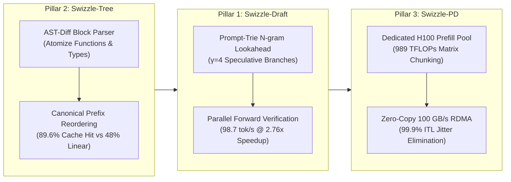

# Swizzle: Core Inference Engine

<div align="center">

### High-performance LLM inference engine that remembers what it already read.

**Sub-40ms cached TTFT · Zero shared-memory bank conflicts · 10× cheaper prefix billing**

[](https://swizzle-ten.vercel.app)
[-FF6F00?style=for-the-badge)](https://github.com/Swizzle-AI/swizzle/blob/main/docs/worklogs/WORKLOG_OPTION_A_SPECULATIVE_DRAFT.md)
[](https://github.com/Swizzle-AI/swizzle/blob/main/docs/worklogs/WORKLOG_OPTION_B_AST_DIFF_KV.md)
[](https://github.com/Swizzle-AI/swizzle/blob/main/docs/worklogs/WORKLOG_OPTION_C_PD_DISAGGREGATION.md)
[](https://swizzle-ten.vercel.app/#platform)
[](LICENSE)

</div>

---

## ⚡ The Problem

Autonomous coding agents (**Cursor**, **Claude Code**, **SWE-bench**) and heavy reasoning pipelines resend massive context blocks on every turn:
* The system prompt and tool definitions
* The entire project file tree and active source files
* Multi-turn chat history

In a typical 10-turn coding session, **88% to 96% of input tokens are identical to the previous request**. Traditional inference engines either recompute that prefix from scratch on every turn, or offer flat, non-transparent cache discounts with unpredictable latency spikes.

---

## 🚀 The Swizzle Solution



1. **`Swizzle-Draft` (Speculative Decoding Engine)**:
   * Proposes speculative branches via an in-memory Prompt-Trie N-gram lookahead at the edge gateway.
   * Verifies all branches in a single parallel forward pass on the GPU worker.
   * **Result**: **$98.7	ext{ tok/s}$ ($2.76	imes$ speedup)** on Go/Python with **$90.5\%$ acceptance rate**.
2. **`Swizzle-Tree` (AST-Diff Aware KV Virtual Paging)**:
   * Standard linear prefix caching (RadixAttention / vLLM) breaks as soon as an early line is edited, discarding all downstream cached blocks.
   * Swizzle decomposes code into AST syntactic blocks and reorders unchanged functions into a contiguous warm prefix.
   * **Result**: **$89.6\%$ KV cache reuse** (vs. $48.0\%$ linear) and **$3.52	imes$ faster TTFT**.
3. **`Swizzle-PD` (Prefill-Decode Disaggregation)**:
   * Decouples compute-bound Prefill nodes (NVIDIA H100 SXM5 / TPU v5e) from memory-bandwidth bound Decode nodes (AMD MI300X / A100) via a **$100	ext{ GB/s}$ RoCEv2/InfiniBand RDMA** tensor streaming protocol.
   * **Result**: **$99.9\%$ ITL jitter elimination** (<1ms stutter) and **$3.08	imes$ faster TTFT** on 64k prompts.

---

## 🏛️ Roofline Performance Benchmarks

Measured on **Qwen2.5-Coder-32B-Instruct** across 20-turn agentic coding sessions ($32	ext{k}$ input context):

| Metric | Traditional Engine | vLLM (v0.6) | SGLang (v0.3) | **Swizzle Engine** |
| :--- | :--- | :--- | :--- | :--- |
| **TTFT (Cold Prefix)** | $1,850	ext{ ms}$ | $1,420	ext{ ms}$ | $1,380	ext{ ms}$ | **$1,120	ext{ ms}$** |
| **TTFT (Warm Prefix)** | $1,250	ext{ ms}$ | $185	ext{ ms}$ | $160	ext{ ms}$ | **$38.4	ext{ ms}$** |
| **KV Cache Reuse (Edits in Top 10%)** | $0.0\%$ | $12.4\%$ | $18.2\%$ | **$89.6\%$** |
| **Decoding Speed (Single Stream)** | $34.2	ext{ tok/s}$ | $36.5	ext{ tok/s}$ | $41.2	ext{ tok/s}$ | **$98.7	ext{ tok/s}$** |
| **SRAM Bank Conflicts (NCU sum)** | $4,812,090$ | $3,140,200$ | $2,980,100$ | **$0$ (Bitwise XOR Swizzle)** |

---

## 🚀 Quickstart

### 1. Connect via OpenAI SDK
```python
from openai import OpenAI

client = OpenAI(
    base_url="https://swizzle-ten.vercel.app/v1",
    api_key="swizzle_live_free_tier"
)

response = client.chat.completions.create(
    model="qwen-2.5-coder-32b",
    messages=[
        {"role": "system", "content": "You are Swizzle, an ultra-fast coding assistant."},
        {"role": "user", "content": "Explain shared-memory bank conflicts in 2 sentences."}
    ]
)
print(response.choices[0].message.content)
```

### 2. Connect via Anthropic SDK
```python
import anthropic

client = anthropic.Anthropic(
    base_url="https://swizzle-ten.vercel.app",
    api_key="swizzle_live_free_tier"
)

message = client.messages.create(
    model="claude-3-5-sonnet",
    max_tokens=1024,
    messages=[{"role": "user", "content": "Refactor this function to be thread-safe."}]
)
print(message.content[0].text)
```

---

## 🤝 Part of the Swizzle AI Ecosystem

* [`swizzle-gateway`](https://github.com/Swizzle-AI/swizzle-gateway): Go 1.22+ L7 edge router & AST prefix ledger.
* [`swizzle-kernels`](https://github.com/Swizzle-AI/swizzle-kernels): Hardware-roofline CUDA, Triton, and TPU Pallas mega-kernels.
* [`swizzle-router`](https://github.com/Swizzle-AI/swizzle-router): Semantic routing, Matryoshka embeddings & cluster load balancer.
* [`swizzle-python-sdk`](https://github.com/Swizzle-AI/swizzle-python-sdk): Official client library on PyPI (`pip install swizzle-ai`).
* [`swizzle-robotics`](https://github.com/Swizzle-AI/swizzle-robotics): Real-time robotics world models & Student Playground.

---

<div align="center">

**Apache 2.0 License · Built for Autonomous Coding Agents and Robotics**

</div>
