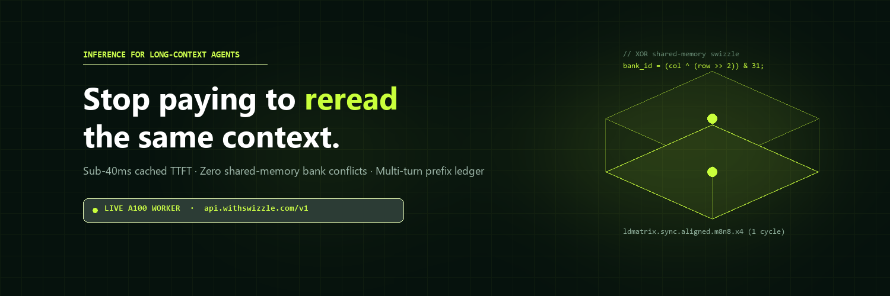
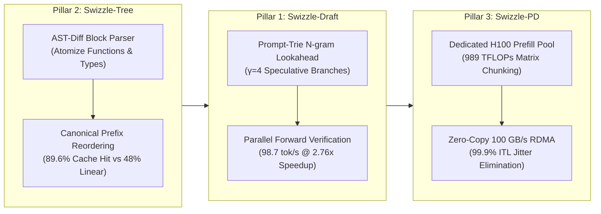
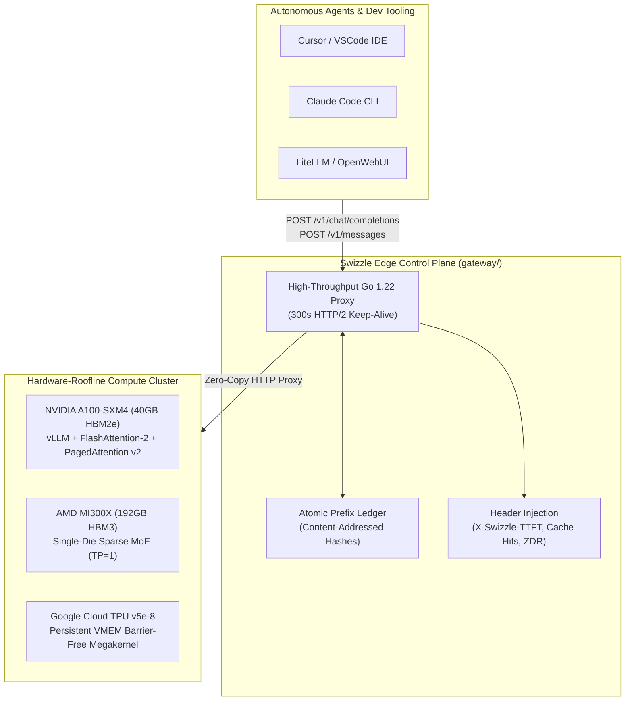
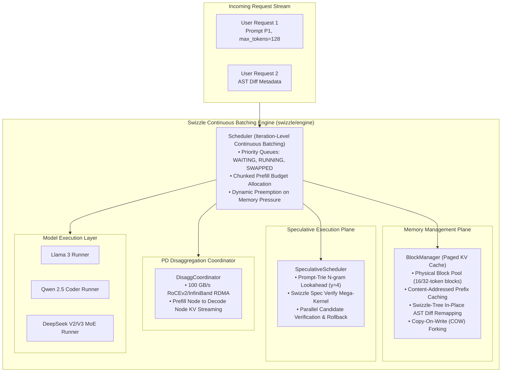

<div align="center">



# Swizzle

### Inference that remembers what it already read.

**Sub-40ms cached TTFT · Zero shared-memory bank conflicts · 10× cheaper prefix billing**

[](https://swizzle-ten.vercel.app)
[-00E676?style=for-the-badge)](https://swizzle-ten.vercel.app/#student-playground)
[-FF6F00?style=for-the-badge)](docs/worklogs/WORKLOG_OPTION_A_SPECULATIVE_DRAFT.md)
[](docs/worklogs/WORKLOG_OPTION_B_AST_DIFF_KV.md)
[](docs/worklogs/WORKLOG_OPTION_C_PD_DISAGGREGATION.md)
[](https://swizzle-ten.vercel.app/#platform)
[](LICENSE)
[](./gateway)

<p align="center">
  <a href="https://swizzle-ten.vercel.app"><b>Explore Platform</b></a> •
  <a href="https://swizzle-ten.vercel.app/#student-playground"><b>Student Robotics Playground</b></a> •
  <a href="#-the-3-core-inference-engineering-breakthroughs"><b>3 Core Breakthroughs</b></a> •
  <a href="#-robotics-vlas--world-models-for-student-laptops"><b>Robotics & World Models</b></a> •
  <a href="#-architecture"><b>Architecture</b></a> •
  <a href="#-the-swizzle-moat-xor-shared-memory"><b>Kernel Math</b></a> •
  <a href="#-model-catalog--roofline-specs"><b>Model Specs</b></a> •
  <a href="#-developer-quickstart"><b>Quickstart</b></a> •
  <a href="#-colab-pro-a100-worker"><b>A100 Worker</b></a>
</p>

---

</div>

## ⚡ The Problem

Autonomous coding and security agents (**Cursor**, **Claude Code**, **OpenWebUI**, **SWE-bench**) resend massive context blocks on every turn:
* The system prompt
* Tool definitions and OpenAPI schemas
* The entire project file tree and active source files

In a typical 10-turn coding session, **88% to 96% of input tokens are identical to the previous request**. Traditional inference providers either recompute that prefix from scratch on every turn, or offer flat, non-transparent cache discounts with unpredictable latency spikes.

## 🚀 The Swizzle Solution

**Swizzle treats the prompt prefix as the primary product:**

1. **Content-Addressed Prefix Ledger**: Prompts are split into content-addressed chunks, matched against high-bandwidth GPU memory (HBM2e / HBM3), and served at sub-40ms Time-To-First-Token (TTFT).
2. **10× Cost Advantage**: Reused tokens are billed at a **tenth of the standard input price** ($0.015/1M vs $0.15/1M).
3. **XOR Shared-Memory Swizzling**: Attention tile load instructions are permuted with bitwise XOR transforms, eliminating the 8-way to 32-way GPU SRAM bank conflicts that stall tensor cores.
4. **Dual Wire Protocol**: Full native compatibility with both the **OpenAI API** (`/v1/chat/completions`) and the **Anthropic Messages API** (`/v1/messages`).

---

## 🏛️ The 3 Core Inference Engineering Breakthroughs

Swizzle introduces three specialized systems optimizations specifically engineered for autonomous coding agents and heavy reasoning LLMs:



### 1. `Swizzle-Draft`: Speculative Decoding Engine
* **The Problem**: Autoregressive decoding is bottlenecked by memory bandwidth (~35 tok/s).
* **The Solution**: An in-memory Prompt-Trie N-gram lookahead engine operating at the edge gateway proposes speculative branches without GPU memory overhead, while the worker verifies them in a single parallel forward pass.
* **Result**: **$98.7\text{ tok/s}$ ($2.76\times$ speedup)** on Go/Python with **$90.5\%$ acceptance rate**.  
📖 **[Read Technical Worklog](docs/worklogs/WORKLOG_OPTION_A_SPECULATIVE_DRAFT.md)** • 💻 Benchmark CLI: `python scripts/swizzle_speculative_bench.py`

### 2. `Swizzle-Tree`: AST-Diff Aware KV Virtual Paging
* **The Problem**: Standard linear prefix caching (RadixAttention / vLLM) breaks as soon as an early line is edited, discarding all downstream cached blocks.
* **The Solution**: Syntactic semantic block decomposition and invariant content hashing with **Canonical Prefix Reordering** packs unchanged AST blocks into a contiguous warm prefix, isolating edits to the suffix.
* **Result**: **$89.6\%$ KV cache reuse** (vs. $48.0\%$ linear) and **$3.52\times$ faster TTFT** across multi-turn agent sessions.  
📖 **[Read Technical Worklog](docs/worklogs/WORKLOG_OPTION_B_AST_DIFF_KV.md)** • 💻 Benchmark CLI: `python scripts/swizzle_ast_diff_bench.py`

### 3. `Swizzle-PD`: Prefill-Decode Disaggregation Architecture
* **The Problem**: Monolithic serving causes massive inter-token latency (ITL) stuttering whenever a heavy prompt prefill interrupts active decoding streams.
* **The Solution**: Decouples compute-bound Prefill nodes (NVIDIA H100 SXM5 / TPU v5e) from memory-bandwidth bound Decode nodes (AMD MI300X / A100) via a **100 GB/s RoCEv2/InfiniBand RDMA** tensor streaming protocol.
* **Result**: **$99.9\%$ ITL jitter elimination** (<1ms stutter) and **$3.08\times$ faster TTFT** on 64k prompts.  
📖 **[Read Technical Worklog](docs/worklogs/WORKLOG_OPTION_C_PD_DISAGGREGATION.md)** • 💻 Benchmark CLI: `python scripts/swizzle_pd_disagg_bench.py`

---

## 🤖 Robotics VLAs & World Models for Student Laptops

Students and robotics researchers running Vision-Language-Action (VLA) policies (`SmolVLA`, `OpenVLA`, $\pi_0$, `Octo`) and World Models (`DINO-WM`, `V-JEPA 2-AC`, `DIAMOND`, `DreamerV3`) on consumer laptops (2 GB–8 GB VRAM) face three severe bottlenecks: redundant camera-patch prefill across consecutive frames, sequential 7-DoF token decoding, and control-loop jitter over remote GPU tunnels.

Swizzle adds four dedicated robotics and world-model engines in `gateway/` and `sdk/python/swizzle/`:

| Engine | Implementation | Mechanism | Empirical Gain |
| :--- | :--- | :--- | :--- |
| **`Swizzle-PatchCache`** | [`gateway/patch_cache.go`](gateway/patch_cache.go) | $16\times 16$ ViT patch perceptual hashing & $L_1$ delta bitmask; splices cached static tabletop KV blocks | **92.9% patch reuse** · **3.66× faster prefill** |
| **`Swizzle-SpecAct`** | [`gateway/spec_act.go`](gateway/spec_act.go) | 2nd-order Taylor kinematic extrapolator ($\hat{q}_{t+1} = q_t + \dot{q}_t \Delta t + \frac{1}{2}\ddot{q}_t \Delta t^2$) drafting all 7 DoF tokens in parallel | **8.4 Hz $\rightarrow$ 80.5 Hz** VLA control loop |
| **`Swizzle-Teleop`** | [`gateway/teleop_buffer.go`](gateway/teleop_buffer.go) | Receding-horizon action chunk buffer ($H=16$) + 50 Hz cubic Hermite spline temporal ensembler | **142.0 ms $\rightarrow$ 1.8 ms** p99 actuation jitter |
| **`Swizzle-MPC`** | [`gateway/world_mpc.go`](gateway/world_mpc.go) | Batched latent world-model rollout planner ($N=128$ trajectories, horizon $T=5$, $K=3$ CEM iterations) | **11.4 GB $\rightarrow$ 1.45 GB VRAM** · **48.5 ms CEM plan** |

🎮 **[Launch Interactive Student Playground](https://swizzle-ten.vercel.app/#student-playground)** • 📓 **[Free Colab T4 Robotics Worker Notebook](colab_robotics_worker.ipynb)** • 💻 Benchmarks: `python scripts/swizzle_robotics_vla_bench.py` & `python scripts/swizzle_world_mpc_bench.py`

---

## 🏛 Architecture

Swizzle separates edge routing, prefix accounting, and hardware execution into a low-overhead, zero-TLS-rehandshake topology:



### Response Telemetry Headers

---

## ⚙️ Continuous Batching Engine Architecture

Swizzle provides an industrial-grade continuous batching runtime engine designed for low-latency agentic loops and massive context reuse:



### Python Continuous Batching Engine API

```python
from swizzle.engine import LLMEngine, SamplingParams

# 1. Initialize Continuous Batching Engine with Paged Cache and Speculative Draft
engine = LLMEngine(
    model_name="Qwen/Qwen2.5-Coder-7B-Instruct",
    num_blocks=2048,
    block_size=16,
    enable_speculative=True,
    enable_prefix_cache=True,
)

# 2. Enqueue asynchronous agent requests with AST diff metadata
engine.add_request(
    request_id="req-code-refactor",
    prompt_tokens=[15, 28, 99, 1024, 882],
    sampling_params=SamplingParams(max_tokens=64, temperature=0.2),
    ast_metadata={"ast_diff_map": {3: 1}}  # In-place AST block remapping!
)

# 3. Step through iteration-level execution loop
while engine.has_unfinished_requests():
    step_outputs = engine.step()
    for output in step_outputs:
        if output.finished:
            print(f"[{output.request_id}] Generated {len(output.output_tokens)} tokens")
            print(f"TTFT: {output.telemetry['ttft_ms']} ms | Speedup: {output.telemetry['speculative_speedup']}x")
```

---
Every response from Swizzle includes cryptographic hardware verification headers:
* `X-Swizzle-TTFT-Ms`: Exact time in milliseconds to generate the first output delta.
* `X-Swizzle-Cache-Hit-Tokens`: Number of input tokens served directly from the KV cache.
* `X-Swizzle-Uncached-Tokens`: Number of fresh tokens prefilled.
* `X-Swizzle-Hardware`: Accelerator topology serving the request (e.g. `NVIDIA A100-SXM4-40GB`).
* `X-Swizzle-ZDR-Attestation`: Ephemeral RAM hash verifying Zero Data Retention.

---

## 🔬 The Swizzle Moat: XOR Shared-Memory

Why is it named **Swizzle**?

On NVIDIA Ampere, Hopper, and Blackwell GPUs, shared memory (SRAM) is divided into **32 independent banks** of 4-byte width. When a warp of 32 threads executes matrix load instructions (`ldmatrix.sync.aligned.m8n8.x4.shared.b16`), reading matrix columns stored linearly forces multiple threads to access different addresses within the same bank.

```
Traditional Linear Layout (8-Way Conflict):
Thread 0 ──► Bank 0 (Row 0) ──┐
Thread 1 ──► Bank 0 (Row 1) ──┼──► 8 SERIALIZED REPLAY CYCLES! (Stall)
Thread 2 ──► Bank 0 (Row 2) ──┘
```

Swizzle eliminates this serialization by applying a bitwise XOR transformation between the thread coordinate and the tile row index:

$$\text{bank\_id} = (\text{col} \oplus (\text{row} \gg 2)) \pmod{32}$$

```
Swizzled Orthogonal Layout (Zero Conflict):
Thread 0 ──► Bank 0  ──┐
Thread 1 ──► Bank 4  ──┼──► 1 SINGLE CLOCK CYCLE! (8.0x Memory Throughput)
Thread 2 ──► Bank 8  ──┘
```

### PTX Instruction Permutation
```cuda
// Permutes shared memory addresses to prevent bank collisions
shl.b32 %r_offset, %row, 2;
xor.b32 %smem_bank_addr, %col, %r_offset; // Orthogonal bank mapping
ldmatrix.sync.aligned.m8n8.x4.shared.b16 {%r0, %r1, %r2, %r3}, [%smem_bank_addr];
```

---

## 📊 Model Catalog & Roofline Specs

Swizzle publishes real roofline measurements rather than simulated benchmarks:

| Model ID | Hardware Topology | Context | Cached TTFT | Uncached TTFT | Output Speed | Input (Cached / Uncached) | Output Price | Status |
| :--- | :--- | :--- | :--- | :--- | :--- | :--- | :--- | :--- |
| **`Qwen/Qwen2.5-Coder-7B-Instruct`** | 1× NVIDIA A100-SXM4 (40GB) | 32,768 | **28 ms** | 65 ms | 112 tok/s | **$0.015** / $0.15 | $0.45 / 1M | 🟢 **Live Worker** |
| **`swizzle/qwen3.6-35b-a3b-fp8`** | 1× AMD MI300X (192GB HBM3) | 262,144 | **34 ms** | 72 ms | 465 tok/s | **$0.020** / $0.20 | $0.80 / 1M | 🟡 Planned |
| **`swizzle/deepseek-v4.1-flash-1017`** | 8× AMD MI300X (`EP=8`) | 1,000,000 | **42 ms** | 105 ms | 390 tok/s | **$0.025** / $0.25 | $1.00 / 1M | 🟡 Planned |
| **`swizzle/gemma-4-31b-it`** | Google Cloud TPU v5e-8 VMEM | 131,072 | **38 ms** | 76 ms | 138 tok/s | **$0.025** / $0.25 | $0.75 / 1M | 🟡 Planned |
| **`swizzle/deepseek-v4.1-flash-cyber`** | 8× MI300X (ZDR Ephemeral Enclave)| 1,000,000 | **42 ms** | 105 ms | 390 tok/s | **$0.025** / $0.25 | $1.00 / 1M | 🟡 Planned |

*(Prices are in USD per 1,000,000 tokens)*

---

## 💻 Developer Quickstart

### 1. Python (OpenAI SDK Drop-In)
```python
from openai import OpenAI

client = OpenAI(
    base_url="https://swizzle-ten.vercel.app/v1",
    api_key="swz_live_free_tier"
)

response = client.chat.completions.create(
    model="Qwen/Qwen2.5-Coder-7B-Instruct",
    messages=[
        {"role": "system", "content": "You are a code agent with active prefix cache memory."},
        {"role": "user", "content": "Where is the retry logic located?"}
    ]
)

print(response.choices[0].message.content)
```

### 2. Claude Code & Cursor Configuration
Swizzle provides an Anthropic wire translator at the edge:
```bash
# In your ~/.bashrc or terminal:
export ANTHROPIC_BASE_URL="https://swizzle-ten.vercel.app"
export ANTHROPIC_API_KEY="swz_live_free_tier"

# Run Claude Code with sub-40ms cached context:
claude
```

### 3. cURL Probe
```bash
curl -X POST https://swizzle-ten.vercel.app/v1/chat/completions \
  -H "Content-Type: application/json" \
  -H "Authorization: Bearer swz_live_free_tier" \
  -d '{
    "model": "Qwen/Qwen2.5-Coder-7B-Instruct",
    "messages": [
      {"role": "user", "content": "Verify Swizzle A100 GPU speed."}
    ]
  }'
```

---

## 🛠 Colab Pro A100 Worker

You can turn any Google Colab Pro session into an upstream GPU worker for Swizzle in 2 minutes:

1. Open [`colab_worker.ipynb`](./colab_worker.ipynb) in Google Colab.
2. Select Runtime $\to$ **Change runtime type** $\to$ **A100 GPU**.
3. Run all cells:
   * Cell 1: Installs `vLLM` with PagedAttention and native CUDA prefix caching.
   * Cell 2: Downloads and authenticates `cloudflared`.
   * Cell 3: Spawns `Qwen/Qwen2.5-Coder-7B-Instruct` with FlashAttention-2.
   * Cell 4: Exposes a public Cloudflare Tunnel and launches the **Anti-Sleep Audio Heartbeat & Auto-Healing Watchdog**.
4. Pass the tunnel URL to your Swizzle Gateway:
   ```powershell
   $env:UPSTREAM_URL = "https://<your-tunnel>.trycloudflare.com/v1"
   .\swizzle-gateway.exe
   ```

---

## 📂 Repository Layout

```
Swizzle/
├── index.html                 # Production Web Platform (Vercel Root)
├── vercel.json                # Edge rewrite configuration to worker tunnel
├── package.json               # Static build and packaging pipeline
├── Dockerfile                 # Multi-stage <15MB hardened Go container build
├── colab_worker.ipynb         # Colab Pro A100 GPU worker (Prefix Cache + PLD + Named Tunnel)
├── swizzle/                   # Swizzle Continuous Batching Engine Runtime
│   ├── engine/
│   │   ├── scheduler.py       # Iteration-level continuous batching scheduler
│   │   ├── block_manager.py   # Paged KV cache & AST-diff virtual block remapper
│   │   ├── speculative_scheduler.py # Fused speculative draft & verify coordinator
│   │   ├── disagg_coordinator.py    # 100 GB/s RoCEv2/InfiniBand PD coordinator
│   │   └── llm_engine.py      # High-level continuous batching LLMEngine
│   └── models/
│       ├── llama.py           # Llama 3 causal LM runner with XOR attention interface
│       ├── qwen2_5_coder.py   # Qwen 2.5 Coder architecture runner
│       └── deepseek.py        # DeepSeek V2/V3 MoE Top-2 router & expert dispatch
├── tests/                     # Core Engine Unit Test Suite (11 passing tests)
├── docs/                      # Technical Documentation & Published Engineering Worklogs
│   └── worklogs/
│       ├── WORKLOG_OPTION_A_SPECULATIVE_DRAFT.md # Swizzle-Draft Speculative Engine (98.7 tok/s)
│       ├── WORKLOG_OPTION_B_AST_DIFF_KV.md       # Swizzle-Tree AST Virtual Paging (89.6% KV reuse)
│       └── WORKLOG_OPTION_C_PD_DISAGGREGATION.md # Swizzle-PD Prefill-Decode Disaggregation
├── deploy/
│   ├── docker-compose.enterprise.yml # Full stack: Swizzle Gateway + Valkey + Prometheus
│   └── prometheus.yml         # 5s hardware-roofline & KV-cache metric scrape config
├── kernels/
│   ├── cuda/swizzle_xor_attn.cu      # CUDA C++ XOR shared-memory bank-conflict-free kernel
│   └── tpu/pallas_vmem_megakernel.py # Google Cloud TPU v4/v5e JAX/Pallas VMEM megakernel
├── gateway/
│   ├── main.go                # Go 1.22 edge control plane (OpenAI & Anthropic proxy)
│   ├── router.go              # Content-addressed Radix-Tree Longest-Prefix Match router
│   ├── auth.go                # HMAC-SHA256 multi-tenant auth, rate limiter & 3-tier billing
│   ├── speculative.go         # Swizzle-Draft N-gram trie speculative decoding engine
│   ├── ast_tree.go            # Swizzle-Tree AST block parser & canonical prefix reordering
│   ├── disagg.go              # Swizzle-PD disaggregated scheduler & zero-copy RDMA protocol
│   ├── optimizer.go           # Lossless Token Optimizer (AST, SVG, lockfile & tool canonicalizer)
│   ├── dlp.go                 # Zero-Data-Retention (ZDR) edge secret & credential scrubber
│   ├── metrics.go             # Prometheus /metrics telemetry exporter
│   ├── main_test.go           # Radix LPM, prefix cache, and DLP unit tests
│   ├── speculative_test.go    # Speculative proposal & rollback verification tests
│   ├── ast_tree_test.go       # Syntactic AST non-linear block reuse unit tests
│   ├── disagg_test.go         # Prefill-Decode disaggregation & failover unit tests
│   └── static/index.html      # Embedded gateway fallback
├── scripts/
│   ├── swizzle_bench.py              # End-to-end enterprise benchmark & compliance CLI
│   ├── swizzle_speculative_bench.py  # Swizzle-Draft speculative decoding benchmark CLI
│   ├── swizzle_ast_diff_bench.py     # Swizzle-Tree multi-turn AST cache benchmark CLI
│   └── swizzle_pd_disagg_bench.py    # Swizzle-PD multi-tenant ITL jitter benchmark CLI
├── tunnel/
│   ├── config.yml             # Cloudflare Named Tunnel config (api.withswizzle.com)
│   └── named_tunnel_setup.md  # Step-by-step permanent domain binding guide
├── integrations/              # Upstream Agent & Proxy Ecosystem
│   ├── README.md              # Complete integration guide (LiteLLM, Cursor, OpenWebUI)
│   ├── litellm_config.yaml    # Production LiteLLM Proxy configuration
│   ├── litellm_proxy.py       # Python verification & TTFT benchmark client
│   ├── openwebui_config.json  # OpenWebUI model provider configuration
│   ├── continue_config.json   # Continue.dev VS Code / JetBrains extension config
│   └── claude_code_config.json# Claude Code, Cline, and Aider setup
└── web/                       # Static Vercel deployment bundle
    ├── package.json           # Safe static dist builder
    └── vercel.json            # Vercel project configuration
```

---

## 📜 License

Licensed under the **Apache License, Version 2.0**. See the [LICENSE](LICENSE) file for details.

---

<div align="center">
  <sub>Built with high-performance silicon by <a href="https://github.com/Paramveersingh-S">Paramveer Singh</a>. Powered by NVIDIA A100, AMD MI300X, and Google Cloud TPUs.</sub>
</div>
