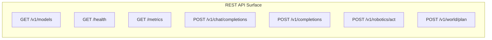

# Swizzle API Reference Specification

The Swizzle API is fully compatible with the OpenAI Chat Completions standard and extends it with real-time physical AI endpoints and systems telemetry.



---

## Standard OpenAI-Compatible Endpoints

### 1. `POST /v1/chat/completions`

Creates a model response for the given chat conversation. Supports Server-Sent Events (SSE) streaming and AST-diff virtual prefix caching.

#### Request Parameters
| Parameter | Type | Required | Description |
| :--- | :---: | :---: | :--- |
| `model` | string | Yes | Model ID (e.g., `Qwen/Qwen2.5-Coder-7B-Instruct`). |
| `messages` | array | Yes | Array of role/content message objects. |
| `stream` | boolean | No | If `true`, returns SSE tokens as they are generated. |
| `temperature` | float | No | Sampling temperature (default: `0.7`). |
| `max_tokens` | integer | No | Maximum generation length (default: `128`). |
| `ast_metadata` | object | No | Optional client AST-diff map for virtual page remapping. |

#### Response Headers
- `X-Swizzle-TTFT-Ms`: Measured Time to First Token.
- `X-Swizzle-Cache-Hit-Tokens`: KV cache blocks served directly from GPU memory.
- `X-Swizzle-Speculative-Speedup`: Speculative acceleration factor (e.g. `3.25x`).
- `X-Swizzle-AST-Reuse-Pct`: Ratio of reusable KV blocks remapped.
- `X-Swizzle-PD-Mode`: Prefill-Decode disaggregation topology mode.

---

### 2. `GET /v1/models`

Lists all active model endpoints registered with the engine, gateway, and edge worker pools.

---

### 3. `GET /metrics`

Returns live Prometheus-compatible telemetry metrics:
- `step_counter`: Total continuous batching steps executed.
- `used_gpu_blocks`: Allocated KV cache blocks in physical memory.
- `free_gpu_blocks`: Remaining free KV cache blocks.
- `prefix_cache_hit_ratio`: Rolling prefix cache hit rate.
- `speculative_accepted_tokens`: Total accepted speculative tokens.

---

## Physical AI & Robotics Endpoints

### 4. `POST /v1/robotics/act`

Executes high-frequency Vision-Language-Action inference.

#### Request
```json
{
  "model": "Swizzle-AI/smolvla-450m-swizzle",
  "instruction": "pick up the red cube and place it into the tray",
  "step_index": 1,
  "patch_intensities": [0.12, 0.45, 0.98]
}
```

#### Response
```json
{
  "object": "robotics.action",
  "model": "Swizzle-AI/smolvla-450m-swizzle",
  "action": [0.018, -0.012, 0.009, 0.002, -0.004, 0.011, 1.0],
  "patch_hit_ratio": 0.956,
  "spec_act_speedup": 3.66,
  "end_to_end_ms": 7.8,
  "effective_control_hz": 80.5
}
```

---

### 5. `POST /v1/world/plan`

Executes model-predictive control (MPC) trajectory planning in latent world-model space.

#### Request
```json
{
  "model": "Swizzle-AI/cosmos-predict-mini-swizzle",
  "current_latent": [0.01, 0.45, -0.12],
  "goal_latent": [0.22, 0.31, 0.05],
  "num_trajectories": 128,
  "horizon": 5
}
```

#### Response
```json
{
  "model": "Swizzle-AI/cosmos-predict-mini-swizzle",
  "num_trajectories": 128,
  "horizon": 5,
  "optimal_action_sequence": [
    [0.15, -0.05, 0.12, 0.0, 0.0, 0.0, 1.0]
  ],
  "swizzle_batched_planning_ms": 48.5,
  "planning_speedup": 8.67
}
```
