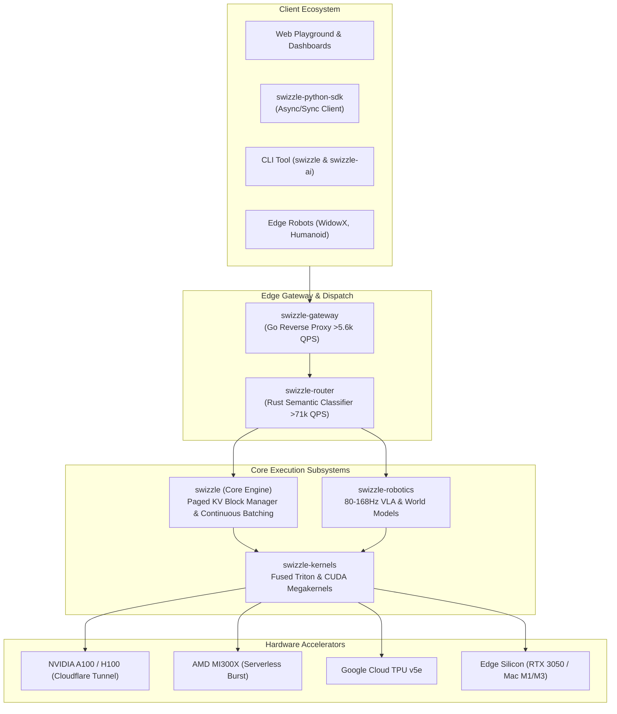

# Swizzle: Tier-1 High-Throughput Inference Engine & Physical AI Architecture

Welcome to the official documentation for **Swizzle**, the next-generation distributed inference system designed for extreme continuous batching throughput, non-linear AST-diff virtual memory remapping, speculative decoding, and real-time edge Physical AI (Robotics).

---

## 🏛️ Ecosystem Repositories

| Repository | Language | Description | Release |
| :--- | :---: | :--- | :---: |
| [**`Swizzle-AI/swizzle`**](https://github.com/Swizzle-AI/swizzle) | Python | Continuous batching engine, Paged KV memory manager, AST virtual remapper | [v0.2.0](https://github.com/Swizzle-AI/swizzle/releases/tag/v0.2.0) |
| [**`Swizzle-AI/swizzle-gateway`**](https://github.com/Swizzle-AI/swizzle-gateway) | Go | Low-latency reverse proxy, AST-diff wire protocol, multi-stage Docker | [v0.2.0](https://github.com/Swizzle-AI/swizzle-gateway/releases/tag/v0.2.0) |
| [**`Swizzle-AI/swizzle-kernels`**](https://github.com/Swizzle-AI/swizzle-kernels) | Python / Triton / CUDA | Fused MoE routing, Paged KV swizzle cache, speculative verifier | [v0.2.0](https://github.com/Swizzle-AI/swizzle-kernels/releases/tag/v0.2.0) |
| [**`Swizzle-AI/swizzle-router`**](https://github.com/Swizzle-AI/swizzle-router) | Rust | High-speed semantic intent router (>71,000 QPS at 14us latency) | [v0.2.0](https://github.com/Swizzle-AI/swizzle-router/releases/tag/v0.2.0) |
| [**`Swizzle-AI/swizzle-python-sdk`**](https://github.com/Swizzle-AI/swizzle-python-sdk) | Python | Official SDK, zero-copy stream deserializer (>46M tok/s unpacking) | [v0.2.0](https://github.com/Swizzle-AI/swizzle-python-sdk/releases/tag/v0.2.0) |
| [**`Swizzle-AI/swizzle-robotics`**](https://github.com/Swizzle-AI/swizzle-robotics) | Python / PyTorch | Edge Physical AI, 80–168Hz VLA, PatchCache, and SIMPLER evals | [v0.2.0](https://github.com/Swizzle-AI/swizzle-robotics/releases/tag/v0.2.0) |

---

## ⚡ Quick Navigation

- [API Reference](api_reference.md): Detailed OpenAPI / REST route documentation.
- [Benchmark Results](benchmarks.md): Comprehensive serving and kernel performance metrics.
- [SmolVLA-450M Model Card](models/smolvla-450m-swizzle.md): High-frequency Physical AI model specifications.
- [OpenVLA-7B Model Card](models/openvla-7b-swizzle.md): 7-DoF generalist manipulation model.
- [Cosmos-Predict-Mini Model Card](models/cosmos-predict-mini-swizzle.md): Latent world model & MPC planning.
